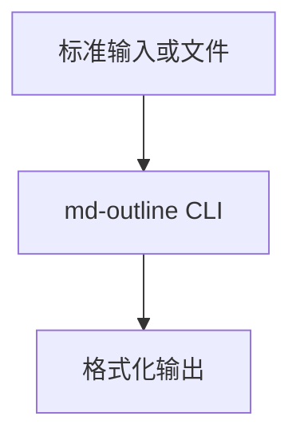
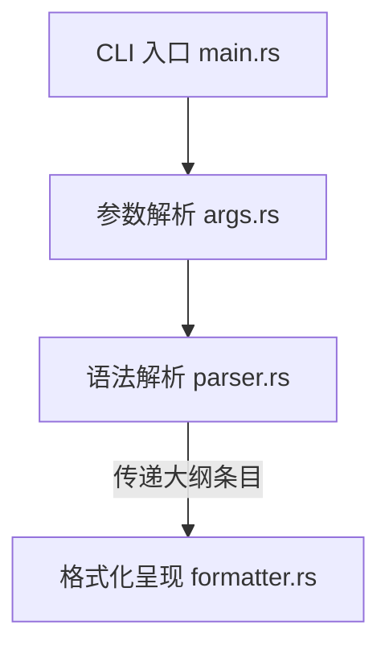

# 系统架构设计

本文档阐述 `md-outline` 的系统分层边界、数据生命周期与关键技术决策。

## 一、系统上下文

`md-outline` 为无状态单二进制命令行工具，运行于宿主操作系统用户空间。从标准输入流或磁盘文件读取 Markdown 字节流，经由流式语法解析与格式化后，向标准输出打印对齐文本或 JSON 数据：

## 二、核心组件

系统划分为三个单向依赖的核心模块：

1. `src/args.rs`：命令行参数定义与校验，决定输出格式与遍历深度。
2. `src/parser.rs`：流式语法解析核心。基于 CommonMark 事件迭代器流式扫描，在根作用域捕获标题事件，剥离格式标记并换算行号。
3. `src/formatter.rs`：纯无副作用渲染层。输入结构化大纲向量，根据目标格式进行对齐计算：
   - `markdown` 模式：输出行号与原生 `#` 标题，内容左对齐；
   - `tree` 模式：输出行号与树形层级连线，内容左对齐；
   - `json` 模式：序列化为结构化数组。

## 三、设计约束

1. 行号准确：行号对应标题首字符在源文件的起始行（从 1 开始）。
2. 零代码块污染：任何缩进块与围栏代码块内部文本严禁识别为标题。
3. 零 Panic 容忍：所有可能出错的路径必须返回 `Result` 向外冒泡。
4. 内存安全性：全仓声明禁止 unsafe 代码。

## 四、架构决策

### 决策一：采用 pulldown-cmark 替代正则表达式

- 状态：已采纳
- 背景：正则表达式无法区分代码块内部的 `#` 注释，容易产生误判。
- 决策：采用流式状态机解析，仅在根作用域触发大纲捕获。
- 代价：增加约 350KB 二进制体积，换取准确的语法解析能力。

### 决策二：行号间距动态自适应

- 状态：已采纳
- 背景：固定空格填充在短行号场景下间距过大，而不填充会导致树状连线断裂。
- 决策：行号居左，根据大纲最大行号动态计算间距，使内容左对齐。
- 代价：需要单次遍历获取最大行号。
