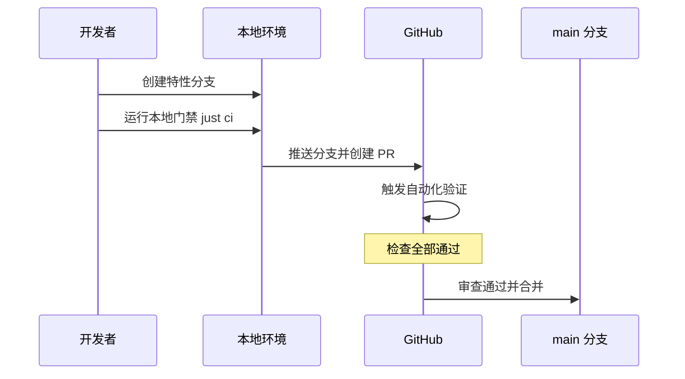
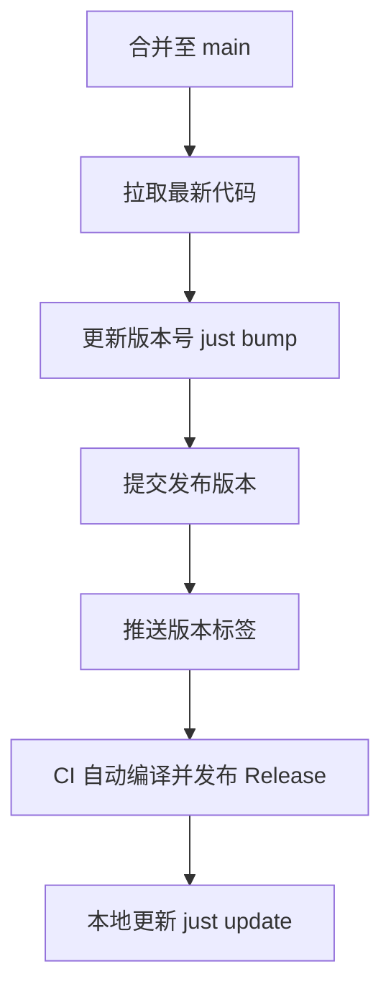

# 开发者协作手册与贡献指南

本项目遵循云端统一构建与自动化分发哲学。本地开发专注于功能实现与质量门禁，所有生产级发布产物均由 GitHub Actions CI/CD 流水线在干净的多平台环境中自动化编译、校验、签名并发布。

## 一、开发环境准备

系统依赖以下标准工具链：

- Rust 工具链：v1.98.0+
- 统一命令运行器：`just`
- 依赖审计工具：`cargo-deny`
- GitHub CLI：`gh`

## 二、本地开发与质量门禁

日常开发遵循测试驱动开发与静态分析约束，提交代码前必须确保门禁全部通过：

```bash
# 执行全量质量门禁：代码格式、Clippy 静态检查、单元与集成测试、安全审计
just ci

# 单项常用命令
just fmt    # 自动格式化代码
just check  # 检查代码格式规范
just lint   # Clippy 静态检查
just test   # 执行全部单元测试与 CLI 端到端验收测试
just audit  # 依赖漏洞与许可证审计
```

### 质量验收门禁

所有代码合并前必须满足以下条件：

1. 零警告约束：生产代码严禁出现 `unwrap()`、`expect()` 与 `panic!()` 宏调用。
2. 内存安全性：全仓声明禁止 unsafe 代码。
3. 测试覆盖：新增特性或修复的缺陷必须在 `tests/cli_test.rs` 包含自动化端到端测试。
4. 格式合规：执行 `cargo fmt` 且校验通过。

## 三、提交规范

提交信息遵循根目录下的 `.gitmessage` 规范。

## 四、合并请求流程

项目采用 PR 模式协作，禁止直接向 `main` 分支推送代码。合并请求遵循 `.github/PULL_REQUEST_TEMPLATE.md` 规范。



1. 基于 `main` 分支拉取最新代码并创建特性分支；
2. 编写测试与功能实现，确保 `just ci` 全部通过；
3. 遵循 `.github/PULL_REQUEST_TEMPLATE.md` 创建合并请求；
4. 自动化验证全部通过后合入主分支。

## 五、版本发布流程

版本发布在 `main` 分支执行，禁止在特性分支夹带发版操作：



1. 拉取主干最新代码：
   ```bash
   git checkout main && git pull origin main
   ```
2. 同步版本号：
   ```bash
   just bump 0.2.1
   ```
3. 提交并推送：
   ```bash
   git add Cargo.toml
   git commit -m "chore(release): bump version to 0.2.1"
   git push origin main
   ```
4. 打标触发构建：
   ```bash
   git tag v0.2.1 && git push origin v0.2.1
   ```

## 六、本地运行态更新

当云端发布完成后，在本地执行更新命令：

```bash
just update
```

脚本自动检测当前平台架构，从最新 Release 下载对应独立二进制并安装至 `~/.local/bin/md-outline`。
